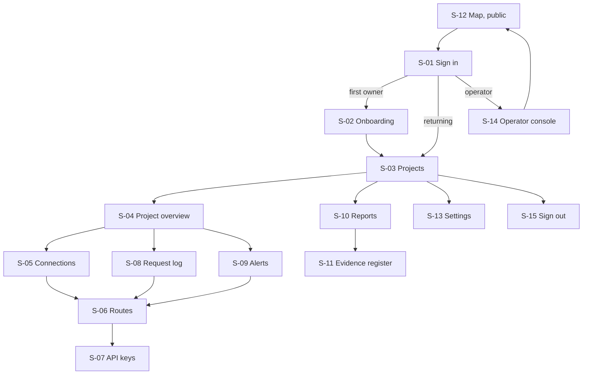

# App flow — MapleRoute

**Question this file answers:** how does each role complete or recover a task?

Roles are defined in [PRD.md](PRD.md#users-and-roles); error codes in [TRD.md](TRD.md#error-contract); tables in [schema.md](schema.md). Timings and limits are author proposals. The API client's "screen" is the HTTP response; its flow is in [API client flow](#api-client-flow).

## Screen and route inventory

Hosts: `console.<domain>` for screens, `api.<domain>` for the data plane. Every screen except S-01 and S-12 requires a session.

| ID | Screen | Route | Roles | Serves |
|---|---|---|---|---|
| S-01 | Sign in | `/login` | anyone | MH-09 |
| S-02 | Onboarding | `/onboarding` | owner (first sign-in) | MH-09, MH-11 |
| S-03 | Projects | `/projects` | owner, engineer, reviewer | MH-01 |
| S-04 | Project overview | `/projects/{pid}` | owner, engineer, reviewer | MH-03, MH-10 |
| S-05 | Connections | `/projects/{pid}/connections` | owner, engineer; reviewer read-only without identifiers of secrets | MH-05 |
| S-06 | Routes | `/projects/{pid}/routes` | owner, engineer; reviewer read-only | MH-02, MH-04, MH-15 |
| S-07 | API keys | `/projects/{pid}/keys` | owner, engineer | MH-01, MH-05 |
| S-08 | Request log | `/projects/{pid}/requests`, `/projects/{pid}/requests/{rid}` | owner, engineer, reviewer | MH-06, MH-13 |
| S-09 | Alerts | `/projects/{pid}/alerts` | owner, engineer, reviewer | MH-10 |
| S-10 | Reports | `/reports`, `/reports/{id}` | owner, engineer, reviewer | MH-07 |
| S-11 | Evidence register | `/evidence` | owner, engineer, reviewer | MH-11 |
| S-12 | Availability map | `/map` | public | MH-08 (reads the published allow-list and watcher date) |
| S-13 | Settings | `/settings/members`, `/settings/data`, `/settings/billing` | owner | MH-09, MH-12, MH-14 |
| S-14 | Operator console | `/ops/allowlist`, `/ops/watcher`, `/ops/routes` | operator | MH-02, MH-08 |
| S-15 | Sign out and error pages | `/logout`, 403, 404 | any | MH-09 |

## Navigation

## Screens

Each entry: story; entry conditions; inputs; visible data; actions and destinations; acceptance checks.

### S-01 Sign in
- **Story.** As a user I sign in with my work Microsoft or Google account.
- **Entry.** No session, or session expired. A deep link is kept and resumed after sign-in.
- **Inputs.** Provider choice. No password or email field exists.
- **Visible.** Two buttons; link to S-12.
- **Actions.** Provider redirect → S-02 (first owner of a new tenant) or the kept link or S-03. Tenant resolution follows the single rule in [TRD.md](TRD.md#8-crosscutting-concepts): a signed-in identity with a membership goes to its tenant; one with a pending invitation link whose email matches its verified email claim accepts it; any other goes to S-02 and creates a new organisation. Email domains are never used to place a user in a tenant.
- **Checks.** Failed provider callback returns here with a message that names no internal detail; a new session token is issued on every sign-in.

### S-02 Onboarding
- **Story.** As an owner I create my organisation and see what MapleRoute stores before I connect anything.
- **Inputs.** Organisation legal name; acknowledgement of the data-handling summary (metadata only; where it is stored; subprocessors, linking to S-11).
- **Actions.** Create → S-03 with one empty project named "Default". Duplicate submit creates one tenant (idempotency token).
- **Checks.** The acknowledgement time and text version are stored; leaving midway and returning resumes the form.

### S-03 Projects
- **Visible.** Project name, number of verified routes, requests and rejections in the last 24 hours, open alerts.
- **Empty state.** "No projects yet. A project is one product or environment with its own keys."
- **Actions.** New project (owner, engineer) → S-04. Reviewer sees no create button.

### S-04 Project overview
- **Visible.** Setup checklist (connection → verified route → key → first request); counts of forwarded, rejected and unknown-outcome requests for 24 hours and 30 days; latest alert; the endpoint URL.
- **Actions.** Each checklist line links to its screen. An unfinished setup reopens at the first incomplete step.
- **Checks.** Counts equal S-08 filtered to the same window.

### S-05 Connections
- **Story.** As an engineer I connect one cloud account with the least access.
- **Inputs, AWS.** Account ID; the role ARN created from the template shown; optional CloudTrail read (checkbox with an explanation of what it adds: provider-recorded region per request). The external ID is generated and displayed.
- **Inputs, Azure.** Subscription, resource group and resource identifiers; the resource's endpoint host; inference key or client secret; reader assignment for configuration.
- **Required customer-side policy.** The screen gives the IAM policy (AWS) or the deny policy assignment (Azure) and states that no route can be verified until MapleRoute reads it in place.
- **Visible.** Per connection: provider, account or resource, state (`pending`, `connected`, `access_failed`, `deleted`), last successful read, whether a secret is stored (yes or no, never its value).
- **Actions.** Save → runs a connection test (processing state, up to 30 s, status announced) → `connected` and on to S-06, or `access_failed` with the provider's error code and the missing permission. Delete connection requires typing the connection name; it stops all its routes at once. The AWS panel adds: "If you remove the role in AWS instead, sessions already issued can last up to 15 minutes."
- **Validation.** Role ARN format; region must be a Canadian one; a secret field is cleared after save and on any error.
- **Review before the external action.** Before saving, the screen lists exactly what MapleRoute will be able to do in the customer's account and what it will not.
- **Checks.** Reviewer sees state but no identifiers of secrets; duplicate submit creates one connection; timeout shows "Test did not finish. Nothing was saved." with Retry.

### S-06 Routes
- **Story.** As an engineer I bind a model alias to a Canada-listed route and see the provider confirm it.
- **Visible.** Table: alias, provider, identifier (and deployment name for Azure), deployment class, destination set, status (`verified`, `unverified`, `suspended`, `not eligible`), customer-side policy (confirmed or missing), content logging in the customer's account (off, on with destination, or not readable), last check time, grade of the check. A second table lists what the connection exposes that is **not** eligible and why ("Destinations reported: ca-central-1, us-east-1, us-east-2, us-west-2").
- **Actions.** Bind alias → verification runs → status. Verify now. Open verification record (the provider's answer, time, allow-list version). Unbind.
- **States.** Empty: "No routes bound. Requests to this project are rejected until one is verified." Partial success: some bindings verified and some not, each row showing its own state; nothing is hidden behind a summary. Suspended (provider definition changed, all tenants): banner with reason and time. Un-verified by `config_mismatch` (this tenant only): row-level reason, for example "Deployment was re-created at 13:47. Type now reported: GlobalStandard."
- **Checks.** A name typed by the user never changes a status; only a provider read does. Covers the mistake in [PRD.md](PRD.md#highest-cost-user-mistake).

### S-07 API keys
- **Actions.** Create key → shown once with a copy button and "You will not see this key again"; revoke (confirm) → effective on the next request.
- **Visible.** Prefix, last four characters, created by, last used, state.
- **Checks.** Refresh after creation does not show the key again; Back does not either.

### S-08 Request log
- **Visible.** Time, request ID, alias, route, allow-list version, decision, code, HTTP status, latency, token counts, provider request ID, provider-recorded region and its grade (or "Not collected", or "Not available for this provider"), and a flag when the request fell in a window where the customer's configuration changed. No prompt, no response, no headers.
- **Inputs.** Filters: time range, decision, code, alias, key. Filters live in the URL.
- **Detail.** `/requests/{rid}` shows one row with its verification record at the time. A request ID from another tenant returns 404.
- **States.** Loading skeleton; empty ("No requests in this range"); export in progress.
- **Batch action.** Export filtered rows as CSV: runs as a job, reports row count, and is safe to re-request (same file for the same filter and time).

### S-09 Alerts
- **Visible.** Suspensions, configuration mismatches, allow-list change notices, rejection summaries, access failures, reconciliation incidents; each with time, affected route and a link to S-06 or S-08. Acknowledge marks who and when.
- **Checks.** A new alert while the page is open is announced without moving focus.

### S-10 Reports
- **Story.** As a reviewer I download the monthly report and know it is the issued one.
- **Visible.** Period, state (`generating`, `ready`, `failed`, `withheld`), allow-list versions covered, SHA-256 of the file, generated time. `/reports/{id}` shows the report on screen with every line's grade and the "Not evidenced" section. Each Azure route line shows the number of matching and failed configuration checks, the longest time requests were served since a matching check (limit 60 minutes) and the count of flagged requests.
- **Actions.** Generate for a custom range (owner, engineer); download PDF, JSON, CSV.
- **States.** `withheld`: "The residency statement is withheld because an asset in the register has no location evidence", linking to S-11. `failed`: reason and Retry; a failed run publishes nothing.
- **Checks.** Download link expires in 5 minutes and uses the public host; reopening the page issues a new link.

### S-11 Evidence register
- **Visible.** MapleRoute assets (compute, database, backups, object store, key store, logs) and subprocessors: role, data seen, country of legal entity, data location, grade, date checked, source. Rows without evidence say "Location not evidenced".
- **Actions.** None for tenant roles; operator edits through S-14.

### S-12 Availability map
- **Visible.** For each provider and model: eligible or not, route identifier, destination set, source page and date read, allow-list version. A line under the title: "Compiled from provider pages and API reads on the dates shown. Provider statements, not independent confirmation."
- **Actions.** "Ask a question" form (name, work email, message) stored in the console database; consent wording covers a reply.

### S-13 Settings
- **Members.** Invite by email (a one-time link; the invitee must sign in through single sign-on with a verified email equal to the invited one); optional "require multi-factor claim" switch; change role; remove (ends sessions).
- **Data.** Log retention (default 13 months); export everything; delete organisation: shows what will be deleted, when backups expire, and requires typing the organisation name. Deletion is irreversible and is the one action with a 24-hour cancel window.
- **Billing.** Plan, usage this month, invoices (Stripe-hosted).

### S-14 Operator console
- **Allow-list.** Versions with hash, approver and time; draft editor that refuses a route failing the eligibility rule; diff against the active version; approve in two steps (review the diff and the tenants affected, then type the version number). A version that removes a route in use activates no sooner than 7 days after approval; affected tenants are alerted at approval.
- **Watcher.** Dated differences between provider snapshots; each marked reviewed, with the resulting allow-list version if any.
- **Routes.** Suspend a route globally with a reason. Resume is offered only when a matching check newer than the suspension exists.
- **Entry.** Separate host; the operator re-authenticates (multi-factor, under 5 minutes old) before approve, suspend or resume.
- **Checks.** Every operator action writes an audit event; the operator sees tenant names and counts, never credentials.

### S-15 Sign out and error pages
- Sign out ends the server session and clears client storage. 403 says which role is needed. 404 is identical for missing and foreign records.

## Cross-screen behaviour

| Situation | Behaviour |
|---|---|
| Refresh | Every screen rebuilds from the server; no state lives only in the page |
| Back and Forward | Filters and pagination are in the URL; a form already submitted shows its result, not a resubmission |
| Deep link | Honoured after sign-in if the role allows; otherwise 403 or 404 |
| Duplicate submission | Forms carry a one-time token; the second post returns the first result |
| Session timeout | 30 minutes idle; a warning at 28 minutes with "Stay signed in"; unsaved secret fields are never restored |
| Permission denied | 403 page; the action's button is absent for that role in the first place |
| Processing | Connection tests, verification, exports and reports show a status region that updates without a reload |
| Unfinished work | S-04's checklist reopens setup at the first incomplete step |

## API client flow

| Step | Client sees |
|---|---|
| Onboard | Change the base URL to `https://api.<domain>/v1` and the key to a project key `[C]` |
| Normal | Provider response plus `X-MapleRoute-Request-Id`, `X-MapleRoute-Route`, `X-MapleRoute-Allowlist-Version` |
| Not eligible, unverified, suspended | 403 or 503 with `code` and `forwarded: false`; the client must not retry `403`; `503` may be retried with backoff and will keep failing until an operator or engineer acts |
| Upstream failure | 502 or 504 with `forwarded: true`; the client decides whether to retry; MapleRoute does not |
| Client timeout | The row may end as `unknown_outcome`; the request ID in S-08 shows the final state |
| Recover | S-09 alert → S-06 to see why → fix the deployment or choose an eligible model |
