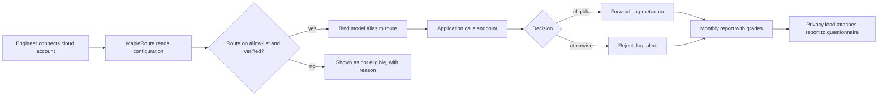

# Product requirements — MapleRoute

**Question this file answers:** what outcome does the user need?

Labels and sources: [Decision.md](Decision.md#how-numbers-are-labelled-used-in-all-ten-files). Evidence grades EG-1 to EG-5: [Decision.md](Decision.md#43-evidence-grades). Targets and limits in this file are author proposals unless tagged.

## Overview

MapleRoute is an OpenAI-compatible endpoint that forwards a request only on a route listed as Canada-processed, rejects everything else, and produces a report that says what each claim rests on `[C]`, reworded per [Decision.md](Decision.md#41-what-keeps-inference-in-canada-today-read-2026-11-10). The customer brings its own cloud account and keys `[C]`. MapleRoute runs no model.

## What the product does

1. Holds a versioned allow-list of routes. A route names a provider, an API host, a source region, a model or profile identifier, and the set of regions the provider says can process it.
2. For each request: authenticates the project key, resolves the requested model to a route bound to that project, checks the route is on the active allow-list and verified, records the decision, and only then forwards.
3. Rejects when any check fails. It never substitutes another route.
4. Re-reads provider and customer configuration on a schedule, including the customer-side deny policy. A change in one customer's account un-verifies that customer's binding; a change in the provider's own definition suspends the route for everyone.
5. Stores request metadata, never prompt or response content.
6. Produces a monthly report and an evidence register in which every line carries a grade.

## Why now

- Canada-only inference profiles and regional deployments exist but cover a small, shifting set of models ([Decision.md](Decision.md#41-what-keeps-inference-in-canada-today-read-2026-11-10)).
- BC public bodies may disclose personal information outside Canada only in accordance with regulations `[S: SRC-16]`, so their vendors are asked where processing happens.
- Not established: that vendors will pay rather than configure it themselves.

## Goals

| Goal | Measure |
|---|---|
| G-1 Answer the decisive question | M-1 |
| G-2 No request leaves the allow-list | M-4 |
| G-3 Reports never claim more than their evidence | M-5 |
| G-4 First paid pilots | M-2 |

## Problem statement

A vendor's engineer must tell a public-sector customer where AI prompts are processed. The engineer cannot tell from a profile name whether a request stays in Canada, has no record to attach, and learns of provider changes by accident `[C]`.

## Buyer

CTO or head of engineering at a Canadian B2B SaaS vendor of 5–100 staff; privacy officer signs off `[C]`. Definitions of paying account and billable unit: [Decision.md](Decision.md#2-who-pays-who-uses-what-is-billed).

## Users and roles

| Role | Who | Can | Cannot |
|---|---|---|---|
| `owner` | The vendor's CTO | Everything within the tenant, including members, deletion and billing | See other tenants |
| `engineer` | The vendor's developer | Projects, connections, routes, keys, request log, alerts | Members, deletion, billing |
| `reviewer` | The vendor's privacy lead | Read routes, verification records, request log, reports, evidence register; download reports | Change anything; see keys or credentials |
| `operator` | MapleRoute staff (the founder) | Allow-list versions, watcher results, route suspension, tenant support metadata | See a credential through any screen or API; read content (none is stored); act inside a tenant without an audit event. The operator is also the infrastructure administrator, so administrator-level access to stored secrets is possible and logged, not prevented ([TRD.md](TRD.md#credential-custody-mh-05-ad-06)) |
| API client | The vendor's application, holding a project key | Call the data-plane endpoints for its project | Anything in the console |

## Current and proposed workflows

**Current `[C]`.** The engineer picks a deployment or profile in the cloud console, ships, and later answers a questionnaire from memory and provider pages.

**Proposed.**

## Highest-consequence failure

**Silent out-of-Canada serve reported as Canadian:** a request is processed outside Canada while MapleRoute's log and report say it stayed in Canada. The vendor then gives its customer a false statement in a security review. This name is used unchanged in [CLAUDE.md](CLAUDE.md) and [verification-report-fixing.md](verification-report-fixing.md). Ways it can happen and the control for each: [TRD.md](TRD.md#highest-consequence-failure-sequence).

## Highest-cost user mistake

The engineer creates an Azure deployment as Global Standard, names it `gpt-4o-canada`, and registers it. **Who reviews:** the route verifier reads `sku.name` from Azure, not the name the engineer typed; the reviewer role sees the verification record. **How it is corrected:** the result is `config_mismatch`, which affects this binding only, never other tenants; the binding stays `unverified` and requests are rejected with `route_unverified`; S-06 shows "Deployment type reported by Azure: GlobalStandard. Not eligible." The engineer redeploys as Standard in `canadaeast` and re-runs verification. MapleRoute never accepts a customer's own description of a deployment in place of the provider's answer. The harder variant, re-creating a verified deployment as Global Standard under the same name, is covered in [TRD.md](TRD.md#residual-window-on-azure).

## Must-haves

Priority P1 is needed for a pilot on the gateway; P2 before the first recurring invoice.

| ID | Priority | User story | Observable acceptance criteria | Owner role |
|---|---|---|---|---|
| MH-01 | P1 | As an API client I send an OpenAI-format chat or embeddings request with a project key and get the provider's answer | `POST /v1/chat/completions` (streaming and non-streaming) and `POST /v1/embeddings` succeed on an eligible route; `GET /v1/models` lists only aliases bound to the key's project; an unknown key returns 401 | engineer |
| MH-02 | P1 | As the operator I publish the allow-list as an immutable numbered version so that eligibility is a lookup, not a judgement | Each version has an identifier, a SHA-256 hash and an approval record; a route absent from the active version is denied; whether a route is listed depends only on the version; each log row stores the version, route status and verification time that decided it, so the decision can be replayed | operator |
| MH-03 | P1 | As an API client I receive a clear refusal when no Canada-listed route applies, and my request goes nowhere | Rejections return the status, `code` and `forwarded: false` defined in [TRD.md](TRD.md#error-contract); no outbound connection is opened; no other route is tried; allow-list or log-store failure also rejects | engineer |
| MH-04 | P1 | As an engineer I see whether the provider's own configuration matches the allow-list before any traffic flows | A binding becomes `verified` only after the provider API reports matching destinations (Bedrock) or deployment type, location, model and version (Azure) **and** the customer-side deny policy is confirmed in place; a matching check older than 24 hours (Bedrock) or 1 hour (Azure) rejects; `config_mismatch` un-verifies that binding only; `definition_mismatch` suspends the route for all tenants; requests inside a detected change window are flagged; the report states the true bound on unobserved Azure time, 15 minutes while checks succeed, and up to 60 minutes (the validity of the last matching check) when checks fail or run late; resuming a suspended route needs a newer match | engineer |
| MH-05 | P1 | As an owner I give MapleRoute the least access it needs, and can revoke it | AWS access is by role assumption with an external ID and a generated least-privilege policy; Azure secrets are stored encrypted and shown never again; credentials appear in no log, export, report, screen or API response; deleting a connection or revoking a key in MapleRoute takes effect on the next request; revoking the role in AWS itself can take up to 15 minutes, the life of an issued session, and the screen says so | owner |
| MH-06 | P1 | As a reviewer I can state that MapleRoute does not keep prompts or outputs | The request log holds only the fields in [schema.md](schema.md#request_log); no setting enables content capture; the canary test finds no prompt text in the database, logs or backups | reviewer |
| MH-07 | P1 | As a reviewer I download a report whose every statement shows what it rests on | Each line carries EG-1 to EG-5; items that cannot be evidenced are printed as "Not evidenced", never omitted; requests with unknown outcome and requests rejected are counted separately; the report states its allow-list versions and file hash | reviewer |
| MH-08 | P1 | As the operator I learn within a day that a provider changed Canadian availability, and no change takes effect without my approval | The watcher records a dated difference; an allow-list change requires a new version approved by the operator; when a version removes a route in use, affected tenants get an `allowlist_change_notice` alert at approval and activation waits at least 7 days; removal that follows a suspension activates at once because the route is already rejecting | operator |
| MH-09 | P1 | As an owner I know other tenants cannot see my projects, logs or reports | Sign-in is by Microsoft or Google single sign-on `[C]`; every table row is tenant-scoped and enforced in the database; cross-tenant identifiers return 404 | owner |
| MH-10 | P1 | As an engineer I am told when requests are being rejected or a route is suspended | Suspension sends an alert within 5 minutes; rejections are summarised hourly; alerts contain no content | engineer |
| MH-11 | P1 | As a reviewer I see where MapleRoute's own compute, database, backups, logs and files are, and who its subprocessors are | The register lists each asset and subprocessor with country, data seen, grade and date checked; an asset without location evidence is shown as "Location not evidenced" and blocks the residency statement in the report | reviewer |
| MH-12 | P1 | As an owner I can export my records and have them deleted | Export produces the request log and reports; deletion disables keys and connections at once, removes tenant rows and credentials within 48 hours (a 24-hour cancel window, then the job), and states when backups expire | owner |
| MH-13 | P1 | As a reviewer I see the region the provider recorded for each request, where the provider exposes one | With CloudTrail read granted, each Bedrock cross-Region request is matched to `inferenceRegion`; a region outside the route's destination set opens an incident, suspends the route and is printed in the report; without the grant the report says "Not collected" | reviewer |
| MH-15 | P1 | As a reviewer I see whether my own cloud account keeps prompts in logs, and where | The verifier reads Bedrock invocation-logging configuration and Azure diagnostic settings for each connection; the report prints off, or on with destination and region (EG-3), or "Not readable"; content logging to a destination outside Canada is a `config_mismatch` | reviewer |
| MH-14 | P2 | As an owner I pay for a plan and see usage | Forwarded requests are counted per month; plan, included requests and overage follow [Decision.md](Decision.md#2-who-pays-who-uses-what-is-billed); rejected requests are not billed | owner |

## Non-goals

No caching, guardrails, prompt management or retries across routes. No fallback to any non-listed route. No content logging or debug capture. No model hosting and no open-weight tier (the brief lists one as optional `[C]`). No Vertex routing (map only). No Quebec-only policy. No UAE or US edition. No certification claim. No AI-drafted questionnaire answers. No stateful provider features (`store`, assistants, files, batch). No password sign-in.

## Dependencies

AWS Bedrock and Azure Canadian regions and their model line-ups `[C]`; the customer's willingness to grant a role or a read-only reader; Stripe; the customer's identity provider; one hour of privacy counsel `[C]`.

## Constraints

- One founder; 1–3 developers `[C]`.
- Eligibility, access decisions and usage arithmetic are deterministic code. No AI function exists in the product.
- All MapleRoute data stays in `ca-central-1`. The founder's VPS is outside the data path ([Decision.md](Decision.md#43-evidence-grades)).
- The gateway is in the request path, so its downtime is the customer's downtime `[C]`.
- Added latency under 50 ms `[C]` is a target, not a measured fact.

## Success metrics

| ID | Type | Metric | Method and source | Denominator | Window | Baseline | Target |
|---|---|---|---|---|---|---|---|
| M-1 | Commercial (decisive) | Share of AI-residency clauses per questionnaire coded RQ-C or RQ-D | Founder codes each clause using [Decision.md](Decision.md#44-which-requirement-is-unmet); second coding by the vendor's privacy lead on the review call | Clauses about AI data location in that questionnaire | Per pilot; summed at day 90 | Unknown | At least one such clause in 2 of the first 3 questionnaires |
| M-2 | Commercial | Paid pilots and paying accounts | Signed agreements and paid invoices | 300 contacts | 90 days | 0 | Section 9.3 of Decision.md |
| M-3 | Commercial | The vendor's customer accepted the answer | Vendor reports yes, no or pending | Pilots delivered | 60 days after delivery | Unknown | Recorded, no target |
| M-4 | Failure | Requests forwarded on a route outside the active allow-list, plus requests flagged `config_changed_window` | Request log joined to allow-list versions; Bedrock reconciliation; Azure change look-back | All forwarded requests | Monthly | — | 0 |
| M-5 | Workflow quality | Report lines whose grade is higher than their source supports | Manual audit of one report a month against the grade catalogue | Lines in the report | Monthly | — | 0 |
| M-6 | Workflow quality | Hours to produce the evidence pack | Founder timesheet against the vendor's own estimate at kickoff | Per pilot | Pilot | 25 hours setup and documentation `[C]`, an assumption | Under 10 founder hours |
| M-7 | Failure | Requests with unknown outcome | Request log state | Forwarded requests | Monthly | — | Under 0.1% |
| M-8 | Workflow quality | Added latency, p95 | Gateway timing minus upstream timing | Forwarded non-streaming requests | Weekly | — | 50 ms or less `[C]` |
| M-9 | Failure | Hours between a provider change and a watcher record | Watcher timestamps against the provider page date | Changes found | Quarterly | — | 24 or less |

## Evidence that would justify expanding the MVP

| Expansion | Evidence required |
|---|---|
| Vertex routing | Two paying accounts using Gemini in Montréal |
| Quebec-only policy | Two questionnaires with an RQ-F clause from prospects who would pay |
| Open-weight tier on Canadian hosting | Three prospects lost to RQ-E |
| Azure per-request region | A provider field found and documented |
| Certification work | A signed deal conditional on it |
