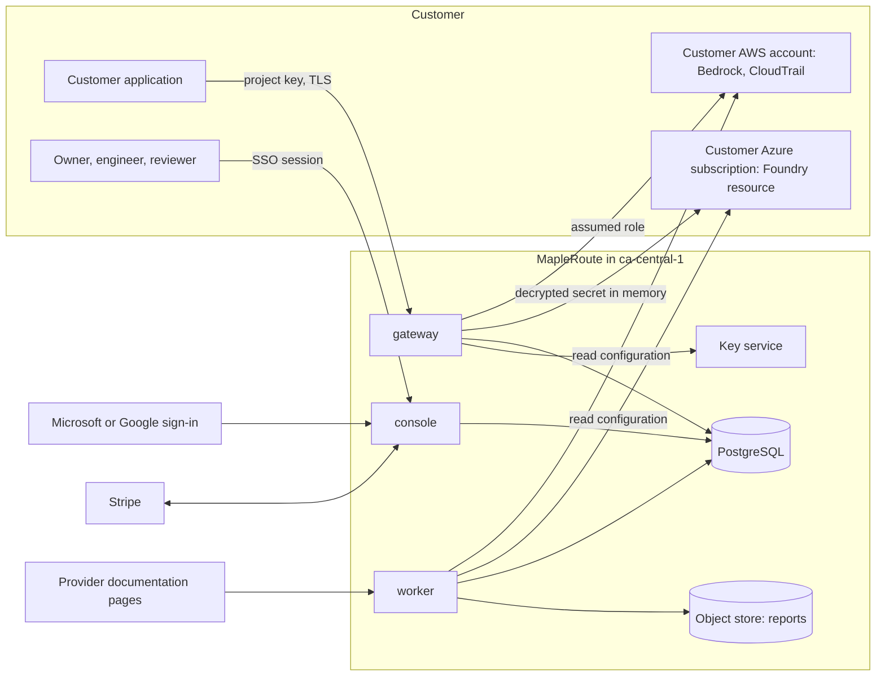
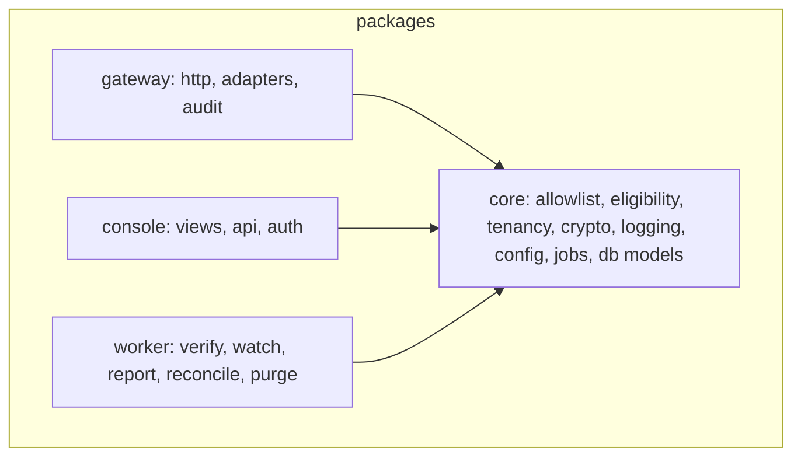
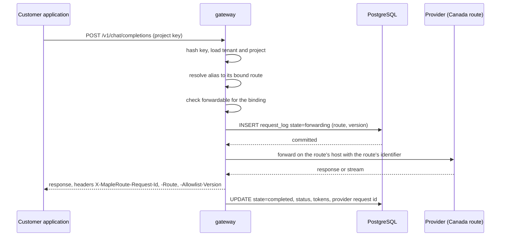
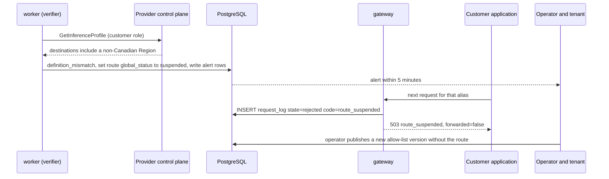
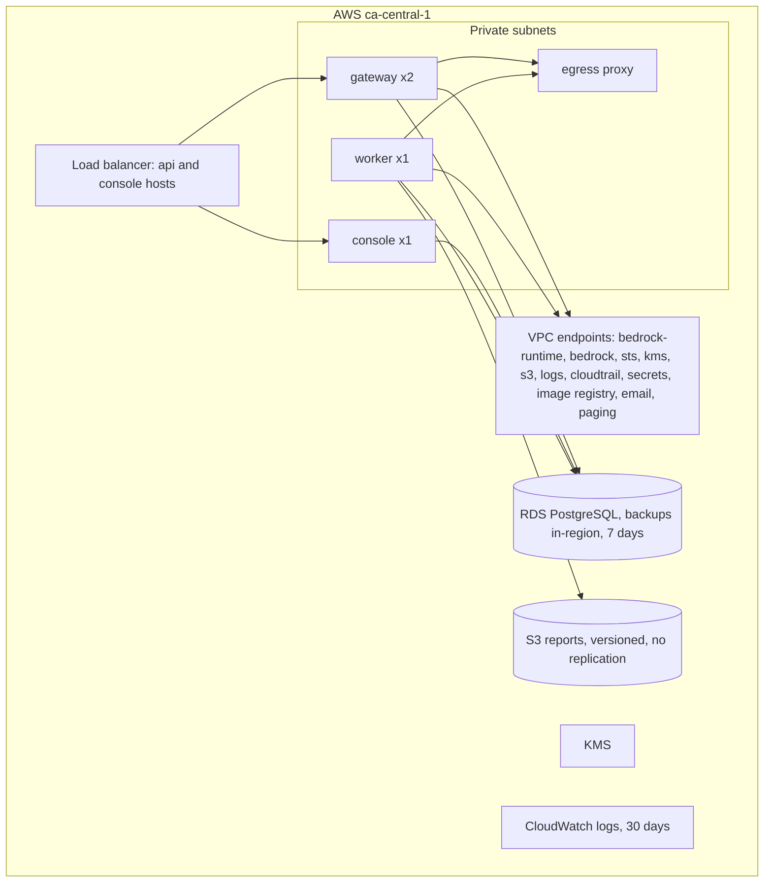

# Technical requirements — MapleRoute

**Question this file answers:** how would the system meet the requirements in [PRD.md](PRD.md)?

Sections follow arc42. Nothing here is built. Every command, script, environment and number is **proposed** by the author unless tagged; labels are defined in [Decision.md](Decision.md#how-numbers-are-labelled-used-in-all-ten-files). Evidence grades EG-1 to EG-5: [Decision.md](Decision.md#43-evidence-grades). Risks are cited by ID from [verification-report-fixing.md](verification-report-fixing.md#production-risk-register).

## 1. Introduction and goals

A deterministic policy proxy with a console and a report generator. Quality goals in order: (1) never forward off the allow-list; (2) never store or log content or credentials; (3) never state more than the evidence supports; (4) stay available, because the gateway is in the customer's request path `[C]`.

## 2. Constraints

- One founder builds and operates it `[C]`.
- All MapleRoute compute, data, backups and logs in AWS `ca-central-1` `[C]`. The founder's VPS is not in the data path (AD-09).
- Customers bring their own Bedrock and Azure accounts `[C]`.
- No AI function. Eligibility, access, usage counts and report totals are deterministic.
- Build milestone B1 (2026-11-11) added `backend/` with the deterministic core and fakes for every provider; infrastructure files still do not exist ([verification-report-fixing.md](verification-report-fixing.md#2a-build-milestone-b1-2026-11-11)).

## 3. Context and scope



| External system | Direction | Data crossing | Trust |
|---|---|---|---|
| Customer application | in | Prompts, responses, project key | Authenticated by key; content passes through memory only |
| Bedrock runtime, `ca-central-1` | out | Prompts, responses | Customer's account; route must be allow-listed |
| Azure Foundry resource | out | Prompts, responses, customer secret | Same |
| AWS and Azure management APIs | out | Configuration reads | Read-only |
| Customer CloudTrail (optional) | in | Event metadata incl. `inferenceRegion` | Read-only |
| Identity providers | in | Name, email, subject identifier | OIDC |
| Stripe | both | Billing contact, plan, usage totals. No request data | Located outside Canada; listed in the register |
| Provider documentation pages | in | Public pages | Untrusted input to the watcher |
| Alert email and paging (AWS services in `ca-central-1`) | out | Alert text: route, code, counts, tenant ID. No content | Same account |
| GitHub (build and deploy) | in | Container images, deploy commands | Holds deploy rights; listed in the register |

Every outbound destination per process is in [Egress destinations](#egress-destinations).

## 4. Solution strategy

| Concern | Choice | Trade-off |
|---|---|---|
| Backend language | Python 3.12, FastAPI, three processes: `gateway`, `console`, `worker` | One language for a small team; lower throughput per core than Go |
| Provider translation | LiteLLM as a library, pinned (AD-03) | Saves writing two adapters `[C]`; its routing, fallback and logging features must stay off |
| Frontend | Server-rendered HTML (Jinja) with htmx (AD-10) | Departs from the brief's Next.js suggestion `[C]`: no second toolchain; less client-side richness |
| Database | PostgreSQL 16 on Amazon RDS, single-AZ at pilot | Row-level security and a job table in one store (AD-07); single-AZ accepts minutes of downtime on failure |
| Storage | S3 bucket in `ca-central-1`, versioned, no replication | Reports only; no user uploads exist |
| Queue and workers | Job table with `FOR UPDATE SKIP LOCKED`; one `worker` process | No Redis to locate, patch or evidence |
| Integrations | Bedrock runtime and control plane, STS, CloudTrail lookup; Azure inference endpoint and Resource Manager; Stripe; OIDC | Each is a named egress destination |
| AI | None | The brief's "no agents" `[C]` is kept |
| Hosting | ECS Fargate behind a load balancer; private subnets; VPC endpoints for AWS services; an egress proxy for Azure hosts | More parts than one VPS; gives location evidence (EG-3) from the provider's API |
| Testing | pytest; provider stubs; a canary-content suite; Playwright for the console | See [execution-plan.md](execution-plan.md#planned-tests) |
| DevOps | GitHub Actions; container images; infrastructure described in OpenTofu | All proposed |

**Operating cost `[A]`, not read from a price list:** about CAD 235 a month at pilot scale (compute 90, load balancer 30, database 50, network egress 45, keys, storage and logs 20). The chat's fixed cost is CAD 2,200 a month with no breakdown `[C]`.

**Deferrable:** second-region standby in `ca-west-1` `[C]`; multi-AZ database; signed reports; Vertex adapter; usage-based billing automation (pilots are invoiced by hand).

## 5. Building block view



`gateway`, `console` and `worker` import only from `core`, never from each other (R-03, R-04, R-06). `core.logging` has no web imports (R-07).

### Eligible routes

A **route** is global and names no customer resource: (provider, source region, deployment class, model identifier, model version for Azure, destination-region set). Route keys: `aws:ca-central-1:geo_ca:ca.anthropic.claude-haiku-5-5`; `azure:canadaeast:Standard:gpt-4o:2024-11-20`. The AWS host follows from the region. The Azure host and deployment name belong to the customer and live on the connection and the binding ([schema.md](schema.md#bindings-and-verification)). The **allow-list** is an immutable, numbered document of routes with a SHA-256 hash and an approval record (AD-12).

```text
CANADA = { aws: {ca-central-1, ca-west-1}, azure: {canadacentral, canadaeast} }
CLASSES = { aws: {in_region, geo_ca}, azure: {Standard, ProvisionedManaged} }

listed(route, version) :=
      route in version.routes
  and route.destinations is non-empty
  and route.destinations ⊆ CANADA[route.provider]
  and route.deployment_class in CLASSES[route.provider]

forwardable(binding, now) :=
      listed(binding.route, active version)
  and binding.route.global_status = active
  and binding.status = verified
  and now - binding.last_verified_at ≤ VALIDITY[provider]     (aws 24 h, azure 1 h)
```

`listed` is pure: the same route and version always give the same answer, at publish time and on every request. A version containing a route that fails it cannot be published. `forwardable` also reads two pieces of state that change over time, the route's global status and the binding's verification. Each log row stores the version, the route status and the binding's `last_verified_at` used, so a decision can be replayed from its row (MH-02). Anything not listed is denied.

First version `2026.11.10-1`, from [Decision.md](Decision.md#41-what-keeps-inference-in-canada-today-read-2026-11-10): 12 Bedrock in-region models and 2 `ca.` profiles; 5 Azure Standard model versions in `canadaeast`; 13 Azure Regional Provisioned entries. 32 routes. Every `us.` and `global.` profile and every Global or Data Zone deployment is absent, so it is denied.

**Three layers (AD-02). L2 is required and checked, not optional.**

| Layer | Where | What refuses |
|---|---|---|
| L1 | Gateway | `forwardable` above |
| L2 | Customer's cloud account | AWS: the role MapleRoute assumes allows `bedrock:InvokeModel*` only on `ca.` inference-profile ARNs and on foundation-model ARNs in the two Canadian Regions; AWS evaluates the destination Regions' model resources for a geographic profile `[S: SRC-04]`, so AWS refuses a `us.` profile. Azure: a policy assignment with deny effect on deployment `sku.name` values outside the eligible classes `[S: SRC-06]`, scoped to the resource group, so Azure refuses to create a Global or Data Zone deployment |
| L3 | MapleRoute network | No general internet egress; only the destinations in [Egress destinations](#egress-destinations) |

A binding cannot become `verified` unless the verifier has confirmed L2 in the customer's account (next section). L3 cannot tell a `us.` profile from a `ca.` one, or a Standard from a Global deployment on the same host. L1 and L2 cover those cases. The three layers are not fully independent: L2 is under the customer's control and is observed only at each check.

### Route verification (MH-04)

| Provider | Reads made with the customer's access | Must hold | Grade |
|---|---|---|---|
| Bedrock, `geo_ca` | `GetInferenceProfile` from the source Region; Regions parsed from each model ARN | Destination set equals the route's, exactly | EG-3 |
| Bedrock, `in_region` | `GetFoundationModel` (API name to confirm at build `[A]`) | Identifier has no geographic prefix and exists in the Region | EG-3 for existence; in-region processing rests on EG-4 |
| Bedrock, L2 | The assumed role's attached and inline policies; a policy simulation of `InvokeModel` on one `us.` profile and one `us-east-1` model `[A]` | Both simulated calls denied | EG-3 |
| Azure, deployment | Resource Manager read of account `location`, deployment `sku.name`, model name and version, and the deployment's creation and last-modified times `[A]` | Location and class eligible; model and version equal the route's; timestamps unchanged since the last matching check | EG-3 |
| Azure, L2 | Policy assignments and exemptions on the resource group | A deny assignment for non-eligible `sku.name` is present, enforced, and not exempted | EG-3 |
| Azure, change look-back | Activity-log events since the previous check `[A]` | No deployment write or delete and no policy assignment or exemption change | EG-3 |
| Both, logging (MH-15) | Bedrock invocation-logging configuration and bucket location; Azure diagnostic settings | Content logging off, or its destination in Canada | EG-3 |

Schedule: before first use; Bedrock every 6 hours with 24-hour validity; Azure every 15 minutes with 1-hour validity. The validity, not the interval, is the worst-case bound: if checks fail or run late, requests keep flowing on the last matching check for up to 1 hour before the binding rejects. No reader access means no check, so the binding ages to `unverified` and requests are rejected.

**One outcome per kind of mismatch.**

| Result | What was read | Effect | Blast radius |
|---|---|---|---|
| `config_mismatch` | Something in the customer's own account: Azure deployment type, location, model or version; a changed timestamp or activity-log change event; a missing or exempted L2 policy; a role broader than the template; content logging to a destination outside Canada; a foundation model not enabled in the account | That **binding** becomes `unverified` at once; requests get `route_unverified`; the tenant is alerted | One binding of one tenant |
| `definition_mismatch` | The provider's own definition of a shared object: a system-defined Bedrock profile whose destinations differ from the route. Bedrock only; Azure exposes no shared definition through a customer account | The **route's** `global_status` becomes `suspended`; requests get `route_suspended`; operator and all tenants bound to it are alerted | Every tenant bound to that route. Deliberate: a changed definition is wrong for all of them. A single faulty read can therefore reject traffic for all until the operator re-reads from MapleRoute's own account |
| `access_failed`, `error` | Nothing usable | No status change; the binding ages out | One binding |

`checked_at` is the end of the provider reads, and a result is decided only while the worker holds the binding lock (the gateway holds the same lock, shared, while it decides and commits a request). A `match` is applied only if its `checked_at` is later than the stored one, so a late result cannot reactivate anything (R-01); a mismatch is always applied, however late, because un-verifying or suspending is never unsafe. Requests are flagged from the start of the reads of the last matching check, with no upper bound. The Azure activity-log look-back starts at the start of the reads of the last check whose reads completed: an `access_failed` or `error` check never moves it, so a period no check read stays open until a completed check covers it. A suspended route is resumed only by the operator **and** only when a `match` newer than the suspension exists for that route (F-011). Each binding is checked independently: a failure on one never stops the checks on the others, and `access_failed`, `error`, "not yet matched" and `unknown_outcome` never count as a pass anywhere, including in the report.

### Residual window on Azure

The gateway calls an Azure deployment by a name on the customer's resource. Nothing found on 2026-11-10 lets the gateway learn the deployment type per request ([Decision.md](Decision.md#11-missing-inputs)). A customer administrator can remove the deny policy, delete a Standard deployment, re-create the same name as Global Standard, and later reverse all three.

| Control | What it does | Limit |
|---|---|---|
| L2 required for `verified` | While the deny policy is assigned, Azure refuses the re-creation | The customer can remove the policy |
| 15-minute checks, 1-hour validity | Bound the unobserved time | **True bound:** 15 minutes while checks succeed, and up to 60 minutes (the validity of the last matching check) when checks fail or run late. After that the binding rejects. Two consecutive failed checks raise an `access_failed` alert to the tenant and the founder |
| Timestamps and activity-log look-back `[A]` | Detect a change that was made and reversed between two checks | Depends on fields and events a reader can see; unverified, see outstanding item O-13 |
| Marking the window | Every request between the last matching check before a detected change and the detection is flagged `config_changed_window` and counted separately | After the fact |
| Report wording | Each Azure route line prints the number of matching checks, the number of failed checks, the longest time requests were served since a matching check (limit 60 minutes), and the count of flagged requests. It reads "configuration matched at each check", never "continuously" | — |

On Bedrock the identifier sent by the gateway (`ca.…` or an un-prefixed model ID) itself selects the route and cannot be renamed by the customer, so this window does not exist there. Test: IT-21.

### Credential custody (MH-05, AD-06)

| Secret | Held as | Application access |
|---|---|---|
| AWS access | No stored secret. Role ARN and external ID; the gateway calls regional STS and holds session credentials in memory for at most 15 minutes | `gateway`, `worker` |
| Azure key or client secret | Ciphertext under a per-connection data key, wrapped by a KMS key in `ca-central-1` with tenant and connection in the encryption context | `gateway` and `worker` task roles decrypt. `console` can encrypt only. No screen or API returns it |
| Project API key | SHA-256 of a 256-bit random token; prefix and last four characters kept for display | None; shown once |
| Console session | Opaque server-side token | `console` |

**What is not claimed.** The founder is the operator and also the administrator of the AWS account, the KMS key policy, the task roles and the deployments. Nothing technical stops that person from granting themselves decrypt rights or assuming a customer's role through the gateway's identity. The true statement is: no application path exposes a credential, and administrator use is logged. Where the customer can see it: every role assumption and Bedrock call appears in the customer's own CloudTrail; Azure calls appear in the customer's own resource logs if enabled. KMS decrypt events sit in MapleRoute's CloudTrail, which the same administrator controls; the monthly report prints the count of decrypt events per principal for the tenant's connections (EG-3, with that caveat). ASVS 13.3.2 is partly met.

**Revocation.** Deleting a connection or revoking a project key in MapleRoute takes effect on the next request, and in-memory session credentials are discarded. Revoking the role inside AWS takes effect when AWS stops honouring sessions already issued: up to 15 minutes, unless the customer also revokes active sessions.

Credentials never enter logs, traces, error text, reports or exports. Deleting a connection destroys its data key.

## 6. Runtime view

### Normal sequence



The log row is committed **before** the upstream call (AD-04). If the insert fails the request is rejected with `audit_unavailable`.

### Highest-consequence failure sequence

The failure is named in [PRD.md](PRD.md#highest-consequence-failure): silent out-of-Canada serve reported as Canadian.

| # | How it could happen | Prevention | Detection | Report behaviour |
|---|---|---|---|---|
| 1 | A non-Canadian identifier reaches the provider through a code path that skips the check | Single forward function that takes a `Decision` object only the evaluator can construct; L2 makes the provider refuse; no fallback code exists | Test IT-03; provider 403 counted | Row shows the rejection |
| 2 | Provider changes a profile's destinations | AWS states geography-tied profiles never change destinations `[S: SRC-03]` (EG-4); verification every 6 hours | `definition_mismatch`; watcher difference | Route suspended; report prints the interval between last matching check and suspension as "configuration not re-confirmed" |
| 3 | Provider processes outside its stated set | None available to MapleRoute | Bedrock reconciliation (MH-13) where granted; otherwise undetectable | Incident printed; otherwise the line stays EG-3 or EG-4, never "confirmed" |
| 4 | Customer registers a Global deployment under a Canadian-sounding name | Deployment type read from Azure, not from the name | Verification record | Binding never verified |
| 8 | Customer re-creates a verified Azure deployment as Global Standard under the same name between checks, or widens the AWS role | L2 required and checked; Azure checked every 15 minutes, rejecting 60 minutes after the last matching check | Timestamps, activity-log look-back, policy read ([Residual window on Azure](#residual-window-on-azure)) | Flagged requests counted as `config_changed_window`; Azure lines state the longest time served since a matching check. A change the provider does not expose to a reader stays undetected: EG-5 |
| 5 | A request is served but its log row is lost | Audit-before-forward | Daily digest count against load-balancer request count | Shortfall printed as "unlogged requests" |
| 6 | The report rounds uncertainty up | Grades fixed per line type in code; unknown outcomes and uncollected fields printed | Metric M-5 audit | — |
| 7 | MapleRoute's own data leaves Canada (backup copy, log export, a tool added later) | Register built from API reads of actual configuration; deny cross-region copy by policy | Daily register job compares configuration with the register | Residency statement withheld while any asset lacks location evidence |



### Error contract

OpenAI-style body: `{"error": {"type", "code", "message", "param", "request_id", "allowlist_version", "forwarded"}}`. `forwarded` is `false` whenever no byte was sent to a provider.

| HTTP | `code` | When | Forwarded |
|---|---|---|---|
| 401 | `invalid_api_key` | Key unknown, revoked or malformed | false |
| 400 | `unsupported_parameter` | Stateful or storage features such as `store: true`, files, batch; a body that is not a JSON object | false |
| 403 | `route_not_eligible` | No route is bound for the alias, or the bound route is not on the active allow-list; `model` longer than 128 characters | false |
| 403 | `route_unverified` | Binding not verified, `config_mismatch`, or last matching check older than the validity period (24 h Bedrock, 1 h Azure); the connection's credential cannot be obtained (role assumption or secret decryption failed) | false |
| 503 | `route_suspended` | `definition_mismatch` or operator suspension | false |
| 503 | `policy_unavailable` | Allow-list missing, unreadable or hash mismatch | false |
| 503 | `audit_unavailable` | Request log insert failed | false |
| 429 | `rate_limited` | Per-key limit exceeded | false |
| 502 | `upstream_error` | Provider returned an error; provider status and error code passed on, provider message text dropped. Also any other adapter exception after the log row is committed: logged by exception class only | true |
| 504 | `upstream_timeout` | No first byte in 60 s | true |

Example message for `route_not_eligible`: "No Canada-listed route is bound to model 'claude-sonnet-5-5' for this project. The request was not sent to any provider." The gateway never retries on another route and never retries upstream calls itself.

### API contracts

| Plane | Endpoint | Auth | Notes |
|---|---|---|---|
| Data | `POST /v1/chat/completions`, `POST /v1/embeddings` | Project key (bearer) | Streaming passes through unbuffered |
| Data | `GET /v1/models` | Project key | Bound, verified aliases only |
| Data | `GET /healthz` | none | No tenant data |
| Console | Screens S-01 to S-15 ([App-flow.md](App-flow.md#screen-and-route-inventory)) | Session | HTML |
| Console | `POST /api/projects/{pid}/connections`, `POST …/connections/{cid}/verify`, `POST …/routes`, `POST …/keys`, `DELETE …/keys/{kid}` | Session, role `owner` or `engineer` | Mutations carry a CSRF token and an idempotency token from the form |
| Console | `GET /api/projects/{pid}/requests`, `GET /api/reports/{id}/file` | Session, any tenant role | File links are signed, 5-minute, built from the public base URL (R-16) |
| Console | `POST /api/ops/allowlist/versions`, `POST …/{id}/approve`, `POST /api/ops/routes/{id}/suspend` | Session, role `operator` | Two-step confirmation |
| Console | `POST /api/webhooks/stripe` | Signature | Idempotent on event ID |

### Jobs, retries, timeouts, idempotency

| Job | Trigger | Idempotency key | Retry | Timeout |
|---|---|---|---|---|
| `verify_binding` | On bind; every 6 h (Bedrock) or 15 min (Azure) | binding and scheduled slot | 3, backoff 1–15 min; failure leaves status unchanged and ages toward `unverified` | 30 s |
| `watch_providers` | Daily 06:00 Pacific | provider and date | 3 | 5 min |
| `sweep_outcomes` | Every 5 min | — | — | 1 min |
| `reconcile_bedrock` | Hourly per connection with the grant | connection and hour | 5; unmatched rows stay "not yet matched" | 5 min |
| `generate_report` | Monthly, and on demand | tenant, period and allow-list set | 3; partial output never published | 10 min |
| `refresh_register` | Daily | date | 3 | 2 min |
| `purge_retention`, `delete_tenant` | Daily; on request | tenant and date | Until done; resumable by cursor | 10 min |
| `send_alert` | On event | alert ID | 5 | 30 s |

Gateway timeouts: connect 5 s, first byte 60 s, total 600 s. `sweep_outcomes` moves rows in `forwarding` for more than 15 minutes to `unknown_outcome`; a later completion may move `unknown_outcome` to `completed` and records `reconciled_at` (R-02). State changes are compare-and-set on the current state (R-01).

### Audit events

Sign-in and failure; member and role change; connection create, verify, delete; key create and revoke; binding change; allow-list publish and approve; route suspend and resume; report generate and download; export; deletion request; operator access to tenant support views. Each has actor, tenant, time, correlation ID and no secrets.

## 7. Deployment view



| | Local | Staging | Production |
|---|---|---|---|
| Start | One command, `make dev` (proposed), brings up database, three processes and provider stubs with health checks (R-17) | Deployed from `main` | Deployed from a tagged release |
| Providers | Stubs only; no real credentials | MapleRoute's own test AWS and Azure accounts | Customer accounts |
| Data | Synthetic | Synthetic | Real metadata; never content |
| Egress | Open | L3 enforced | L3 enforced |
| Region | Developer machine | `ca-central-1` | `ca-central-1` |

### Egress destinations

L3 allows exactly these. "Endpoint" means a VPC endpoint in `ca-central-1`; "proxy" means the egress proxy with a host allow-list. Locations of non-AWS hosts are the operators' global services and are **not evidenced as Canadian**; the column says what crosses.

| Process | Destination | Path | Data crossing |
|---|---|---|---|
| gateway | Bedrock runtime, STS, KMS, logs | Endpoint | Prompts and responses (Bedrock); role assumption; key unwrap |
| gateway | Customer Azure inference hosts of verified connections | Proxy, exact host names | Prompts and responses; customer key |
| gateway, worker | `login.microsoftonline.com`, only for connections using a client secret | Proxy | Client ID and secret; no content |
| worker | Bedrock control plane, CloudTrail, STS, KMS, S3, logs, email and paging services | Endpoint | Configuration reads; event metadata; alert text |
| worker | AWS IAM (global endpoint) | Proxy | Role policy reads and simulation |
| worker | `management.azure.com` (global endpoint) | Proxy | Deployment, policy, activity-log and diagnostic-setting reads |
| worker | `docs.aws.amazon.com`, `learn.microsoft.com`, `docs.cloud.google.com` | Proxy | Outbound: URL only |
| console | `login.microsoftonline.com`, `accounts.google.com`, `oauth2.googleapis.com`, `www.googleapis.com` | Proxy | Sign-in redirects, tokens, signing keys |
| console | `api.stripe.com` | Proxy | Billing contact, plan, usage totals |
| console | KMS, S3, logs, email service | Endpoint | Encrypt; signed links; invitations |
| all | Image registry, secret store | Endpoint | Images; MapleRoute's own secrets |

Inbound only: the load balancer; Stripe webhooks; the external uptime probe on `/healthz`; GitHub's deploy role (no network path into the VPC; it calls the AWS API). Alerts go to tenants by email and to the founder by page from AWS services in `ca-central-1` `[A]`; pages carry tenant IDs, not names. IT-20 tests one allowed and one refused host per process.

- **Deployment.** Rolling replacement of tasks; migrations run first as a one-off task and are backward-compatible for one release (R-09, R-10, R-11).
- **Rollback.** Redeploy the previous image tag; allow-list rollback is publishing a new version equal to an earlier one, never editing.
- **Backup.** RDS automated backups and snapshots stay in `ca-central-1`; cross-region copy is denied by policy. Bucket versioning for reports.
- **Restore.** Point-in-time restore to a new instance, then switch. Proposed recovery point 5 minutes, recovery time 2 hours. While the database is down the gateway rejects with `audit_unavailable`.
- **Persistent state.** Containers are stateless; state is in RDS, S3 and KMS only (R-15).
- **Configuration.** Environment variables read once by `core.config`; secrets from the platform's secret store; no configuration file is copied between processes (R-06).

| Alert | Owner | Response |
|---|---|---|
| Any forwarded request off the allow-list; reconciliation out-of-set region | Founder, immediately | Incident runbook: suspend route, notify affected tenants the same day, record in the next report |
| Route suspended; verifier failing twice in a row (Azure, about 30 minutes) or for 12 h (Bedrock) | Founder | Check provider; publish new version if needed |
| `audit_unavailable` or `policy_unavailable` above 1% for 5 minutes | Founder | Restore database or allow-list |
| Register drift | Founder | Withhold residency statement until resolved |
| Error rate, latency, queue age above 15 minutes | Founder | Scale or roll back |

One person is on call; there is no second responder. That is an accepted gap.

## 8. Crosscutting concepts

- **Identity.** Console users sign in through Microsoft or Google OIDC `[C]` (AD-13). No passwords and no email links. API clients use project keys. A user is identified by (identity provider, subject), never by email or email domain. **One tenant-resolution rule:** a signed-in user with no membership either creates a new tenant in S-02 and becomes its owner, or accepts an invitation; an invitation is a one-time link bound to an email address and is accepted only when the signed-in identity's verified email claim equals it, after which the membership is bound to the subject. Nobody joins a tenant because of an email domain.
- **Operator sign-in.** `/ops` is served on a separate host, limited to the founder's Entra ID account, and requires an ID token whose `amr` claim shows multi-factor authentication `[A]` and whose authentication time is under 5 minutes old before approve, suspend or resume (re-authentication). Tenant owners may switch on the same `amr` check for their users; where an identity provider sends no such claim it cannot be checked.
- **Tenancy.** Every tenant table has `tenant_id`; PostgreSQL row-level security reads a session setting that `core.tenancy` sets once per request or job from the authenticated context. The three processes use different database roles, and the console's `/ops` routes a fourth ([schema.md](schema.md#roles-and-permissions)); the three privileged functions are owned by a non-superuser definer role with `pg_temp` last in their search path. Object keys start with the tenant ID (R-05, R-13).
- **Logging.** Structured JSON; a correlation ID equal to the request ID travels through gateway, jobs and retries (R-12). An allow-list of loggable fields; bodies, headers named `authorization` or `api-key`, and provider error text are never passed to the logger.
- **No content persistence (AD-05).** Request and response bodies exist only in process memory. No temp files, no body hashes, no tracing payloads, no debug switch.
- **Threat model.**

| Asset | Boundary | Abuse case | Control |
|---|---|---|---|
| Prompts and responses | Application to gateway to provider | Operator or attacker reads content from logs or database | AD-05; canary test IT-06 |
| Provider credentials | Console to database to gateway | Database dump yields usable secrets | Envelope encryption; no AWS secrets stored; decrypt limited to two task roles |
| Project keys | Customer code to gateway | Leaked key used by a third party | Hash at rest; revoke; per-key rate limit; last-used time shown |
| Allow-list | Operator to gateway | Malicious or mistaken entry adds a US route | Publish-time rule check; hash; approval record; L2 still refuses |
| Tenant data | Console | One tenant reads another's log | Row-level security; 404 on foreign IDs; IT-08 |
| Watcher input | Public pages to worker | Altered page triggers a wrong change | Watcher only proposes; operator approves; verification uses APIs, not pages |
| Report | Worker to reviewer | Report altered after issue | Stored hash printed in the console; versioned bucket |

- **Security requirements (OWASP ASVS 5.0.0 `[S: SRC-22]`).** Planned controls. Planned is not verified; nothing below is a compliance claim.

| Requirement | Planned control | Status |
|---|---|---|
| 6.3.3 multi-factor; 6.8.4 authentication strength from the identity provider | Operator: `amr` and recent authentication checked. Tenant users: checked only if the owner enables it and the provider sends the claim | **Partly met**: off by default for tenants; Google's claim support unverified |
| 6.3.6 email not an authentication mechanism | No email-based sign-in or recovery exists; invitations grant nothing without single sign-on | Planned |
| 6.8.1 identity not spoofable across providers; 10.5.2 user identified by `sub` | Identity key is (provider, subject) | Planned |
| 6.8.2 assertion signatures validated; 10.5.1 nonce; 10.5.3 issuer match; 10.1.2, 10.2.1 flow bound to the session with PKCE and state | Standard OIDC code flow with a maintained library | Planned |
| 3.3.1, 3.3.2, 3.3.4 cookie attributes; 3.4.1 HSTS; 3.5.1 cross-origin request validation | `__Host-` session cookie, Secure, HttpOnly, SameSite=Lax; HSTS one year; anti-forgery token on every mutation | Planned |
| 7.2.1, 7.2.4, 7.4.1 session verification, renewal, termination; 7.3.1 inactivity timeout | Server-side sessions, new token at sign-in, invalidated at sign-out, 30-minute idle timeout | Planned |
| 7.5.3 further authentication before highly sensitive operations | Operator re-authentication before approve, suspend, resume. Tenant deletion uses confirm-by-typing only | **Partly met** |
| 8.4.2 layered protection of administrative interfaces | Separate host, single account, multi-factor claim. No device posture or contextual risk analysis | **Not met** beyond those three |
| 8.2.1, 8.2.2, 8.3.1 function and data access at a trusted layer | Role checks in `core`; row-level security | Planned |
| 8.4.1 cross-tenant controls | Row-level security and tenant-prefixed keys | Planned |
| 11.1.1 key management policy | One-page key lifecycle document | Planned |
| 12.1.1, 12.2.1, 12.3.1 TLS inbound and outbound | TLS 1.2 or later everywhere | Planned |
| 13.2.4, 13.2.5 outbound allow-list | L3 | Planned |
| 13.3.1 secrets management | KMS and platform secret store | Planned |
| 13.3.2 least privilege for secrets | Split encrypt and decrypt roles; the account administrator can override | **Partly met** |
| 13.3.4 secret rotation | Customer secrets rotate on the customer's schedule; MapleRoute's own yearly | **Partly met** |
| 14.1.1, 14.2.4, 14.2.7 classification, handling, retention | Sensitivity column in [schema.md](schema.md#sensitivity-and-retention) | Planned |
| 14.2.1 no sensitive data in URLs | Keys in headers only | Planned |
| 16.1.1, 16.2.1, 16.2.5, 16.3.1, 16.3.3 logging inventory and content | Field allow-list; audit events above | Planned |
| 16.4.2 logs protected from modification | Insert-only database role and a daily digest. A database administrator could still alter rows | **Partly met** |
| 16.5.1, 16.5.3 generic errors, fail securely | Error contract; every failure path rejects | Planned |
| 2.4.1 anti-automation | Per-key rate limit | Planned |

## 9. Architecture decisions

| ID | Decision | Reason |
|---|---|---|
| AD-01 | Deterministic policy proxy; `listed` is a pure function over a versioned document, and every input to `forwardable` is stored on the log row | Routing eligibility must be reproducible |
| AD-02 | Three enforcement layers; L2 in the customer's account is a precondition of `verified` and is re-read at every check | One bug must not be enough for the highest-consequence failure; an unverified template would be a claim without a control |
| AD-14 | Two mismatch kinds with different blast radius; routes carry no customer host | A customer's misconfiguration must not reject other tenants; a provider change must reject all |
| AD-03 | LiteLLM as a pinned translation library; router, fallbacks, caching and callbacks unused; upgrades gated on IT-03 and IT-06 | The brief suggests it as the proxy core `[C]`; its fallback features contradict fail-closed |
| AD-04 | Audit before forward | A served request without a record would falsify the report |
| AD-05 | No content persistence anywhere | Zero prompt retention default `[C]`, made the only mode |
| AD-06 | Role assumption for AWS; envelope-encrypted secrets for Azure | Least stored secret |
| AD-07 | PostgreSQL only | Fewer components to locate and evidence |
| AD-08 | Single region, no cross-region copies; standby deferred | Every copy must be in Canada and in the register |
| AD-09 | Founder VPS excluded from the data path until its Canadian location is documented | [Decision.md](Decision.md#43-evidence-grades) |
| AD-10 | Server-rendered console | One toolchain |
| AD-11 | Evidence grade attached to each report line type in code | Prevents overstated claims |
| AD-12 | Allow-list versions immutable, hashed, operator-approved in two steps | Accountability for the one document that defines eligibility |
| AD-13 | Single sign-on only | No password or email factor to defend |

## 10. Quality requirements

All targets proposed. All verification is future work.

| Attribute | Workload | Target | Future verification |
|---|---|---|---|
| Fail-closed | 10,000 mixed requests incl. 50 kinds of ineligible input | 0 forwarded off-list | IT-03; load test IT-12 with a stub counting outbound calls |
| Added latency | 20 requests a second, non-streaming | p95 ≤ 50 ms `[C]` | IT-12 |
| Throughput | 500K requests a month per account `[C]`, 20 accounts ≈ 4 a second average, 40 peak | No queueing | IT-12 |
| Availability | Monthly | 99.5% (about 3.6 hours down) | External probe |
| Data loss | Database failure | ≤ 5 minutes of log rows | Restore drill IT-13 |
| Restore time | Full database loss | ≤ 2 hours | IT-13 |
| Verification freshness | All bindings | Age ≤ 24 hours (Bedrock) or ≤ 1 hour (Azure), or rejected | IT-05 |
| Azure unobserved window | Each Azure binding | ≤ 15 minutes while checks succeed; ≤ 60 minutes when they fail, then rejected | IT-21 |
| Alert delay | Route suspension | ≤ 5 minutes | IT-10 |
| Job queue age | All jobs | ≤ 15 minutes | Metric |

## 11. Risks and technical debt

The 22 production risks are in [verification-report-fixing.md](verification-report-fixing.md#production-risk-register). Product-level technical risks: request-path dependency `[C]`; reliance on provider statements for location `[C]`; a thin eligible model set; single operator; LiteLLM upgrade drift; no per-request provider field on Azure, hence a residual window of 15 minutes while checks succeed and up to 60 minutes when they fail.

## 12. Glossary

| Term | Meaning |
|---|---|
| Route | See [Eligible routes](#eligible-routes) |
| L2 | The customer-side policy that makes the provider itself refuse a non-Canadian route |
| Binding | A project's link from a model alias to a route through one provider connection |
| Destination set | Regions the provider says may process a route |
| Verification | An API read confirming provider configuration matches a route |
| Fail closed | Reject and forward nothing when any check cannot be completed |
