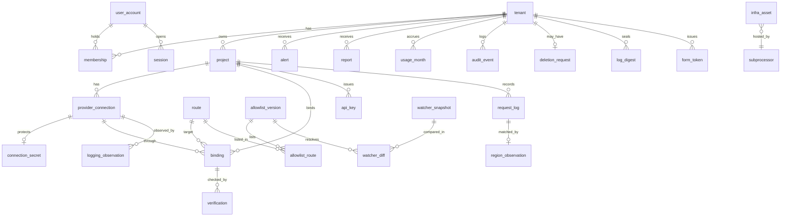

# Schema — MapleRoute

**Question this file answers:** what data exists, who owns it, and how does it change?

PostgreSQL 16. Build milestone B1 (2026-11-11) implemented the tables the core needs in `backend/migrations/sql/0001_core.sql` (models in `backend/core/models.py`); build milestone B2 added `session`, `local_credential`, `email_challenge`, `report` and the invitation columns of `membership` (`0007_local_auth_storage.sql`); the remaining tables are still proposed. B1 deviations are listed in [verification-report-fixing.md](verification-report-fixing.md#2a-build-milestone-b1-2026-11-11). Requirements: [PRD.md](PRD.md#must-haves). Runtime rules: [TRD.md](TRD.md). There is **no table or column for prompt or response content**, by design (AD-05).

## Entity-relationship diagram

`job` and `map_inquiry` have no foreign-key relationships and are not drawn.

## Conventions

- Primary keys are `uuid` (version 7) named `id` unless stated. Times are `timestamptz` in UTC. Every table has `created_at timestamptz not null default now()`.
- **T** marks a tenant-scoped table: it has `tenant_id uuid not null references tenant(id)` and a row-level security policy `tenant_id = current_setting('app.tenant_id')::uuid`. Foreign keys between T tables include `tenant_id` so a row cannot reference another tenant's parent.
- "Unique" states its scope.

## Dictionary

### Identity and tenancy

| Table | Field | Type | Null | Default / constraint |
|---|---|---|---|---|
| `tenant` | `legal_name` | text | no | — |
| | `state` | text | no | `active`; check in (`active`, `deletion_pending`, `deleted`) |
| | `plan` | text | no | `pilot`; check in (`pilot`, `starter`, `pro`, `business`) |
| | `log_retention_months` | int | no | 13; check 1–24 |
| | `require_mfa_claim` | bool | no | false |
| | `handling_ack_version`, `handling_ack_at` | text, timestamptz | yes | set in S-02 |
| | `stripe_customer_id` | text | yes | unique (global) |
| `user_account` | `idp`, `idp_subject` | text | no | unique (`idp`, `idp_subject`) global |
| | `email`, `display_name` | text | no | email not unique; identity is the subject |
| | `is_operator` | bool | no | false |
| `membership` T | `user_id` | uuid | yes | references `user_account`; unique (`tenant_id`, `user_id`) |
| | `role` | text | no | check in (`owner`, `engineer`, `reviewer`) |
| | `invited_email`, `invite_token_hash`, `invite_expires_at`, `accepted_at` | text, bytea, timestamptz, timestamptz | yes | `user_id` is null until acceptance; acceptance requires the verified email claim to equal `invited_email`, then binds the subject. As built (B2): unique (`invite_token_hash`), cleared at acceptance; check `ck_membership_member_or_invite`; accepted only through `accept_invitation()` |
| `session` | `user_id`, `token_hash`, `expires_at`, `last_seen_at` | uuid, bytea, timestamptz, timestamptz | no | unique (`token_hash`); deleted at sign-out |
| | `tenant_id`, `idp`, `amr`, `auth_time` | uuid, text, text[], timestamptz | `tenant_id` yes | B2: the chosen tenant (re-checked against membership on every request), the provider, its `amr` and the time of the last authentication; check `expires_at > auth_time`; index (`user_id`); cascade on user and tenant deletion |
| `local_credential` (B2) | `user_id` (key), `email_normalised`, `password_hash`, `totp_ciphertext`, `totp_wrapped_key`, `totp_kms_key_arn`, `totp_confirmed_at`, `totp_last_step`, `failed_count`, `locked_until` | mixed | mixed | Local identity provider only; unique (`email_normalised`); Argon2id hash; TOTP seed envelope-encrypted with context (user, `totp_seed`); `totp_last_step` refuses a replayed code; check `failed_count >= 0` |
| `email_challenge` (B2) | `purpose`, `email_normalised`, `token_hash`, `expires_at`, `used_at` | text, text, bytea, timestamptz, timestamptz | `used_at` yes | One-time enrolment link; unique (`token_hash`); `purpose` check in (`enrol`) |
| `form_token` T | `token`, `result_ref`, `used_at` | uuid, text, timestamptz | mixed | unique (`tenant_id`, `token`); purged after 24 h |

### Projects, connections, keys

| Table | Field | Type | Null | Default / constraint |
|---|---|---|---|---|
| `project` T | `name` | text | no | unique (`tenant_id`, `name`) |
| `provider_connection` T | `project_id` | uuid | no | — |
| | `provider` | text | no | check in (`aws`, `azure`) |
| | `account_ref` | text | no | AWS account ID or Azure resource ID; unique (`project_id`, `provider`, `account_ref`) |
| | `source_region` | text | no | check in (`ca-central-1`, `ca-west-1`, `canadacentral`, `canadaeast`) |
| | `role_arn`, `external_id` | text | yes | AWS only; both required when `provider = 'aws'` (check) |
| | `endpoint_host`, `resource_group` | text | yes | Azure only: the customer's own resource host and the scope of the deny policy; required when `provider = 'azure'` (check) |
| | `cloudtrail_read` | bool | no | false |
| | `state` | text | no | `pending`; check in (`pending`, `connected`, `access_failed`, `deleted`) |
| | `last_read_ok_at` | timestamptz | yes | — |
| `connection_secret` T | `connection_id` | uuid | no | primary key; Azure only |
| | `ciphertext`, `wrapped_data_key`, `kms_key_arn` | bytea, bytea, text | no | no plaintext column exists |
| | `rotated_at` | timestamptz | yes | — |
| `api_key` T | `project_id` | uuid | no | — |
| | `key_hash` | bytea | no | SHA-256; unique (global) |
| | `prefix`, `last_four` | text | no | display only |
| | `state` | text | no | `active`; check in (`active`, `revoked`) |
| | `created_by`, `revoked_at`, `last_used_at` | uuid, timestamptz, timestamptz | mixed | — |

### Allow-list and routes (global, operator-owned)

| Table | Field | Type | Null | Default / constraint |
|---|---|---|---|---|
| `allowlist_version` | `version` | text | no | primary key, e.g. `2026.11.10-1` |
| | `document` | jsonb | no | canonical list of routes; never updated (trigger rejects UPDATE and DELETE) |
| | `sha256` | bytea | no | hash of the canonical serialisation |
| | `state` | text | no | `draft`; check in (`draft`, `active`, `superseded`); **at most one `active`** (partial unique index) |
| | `approved_by`, `approved_at`, `activate_after`, `activated_at` | uuid, timestamptz, timestamptz, timestamptz | yes | approval fields required when not `draft` (check); `activate_after` ≥ approval + 7 days when the version removes a route in use |
| `route` | `id` | text | no | primary key, e.g. `aws:ca-central-1:geo_ca:ca.anthropic.claude-haiku-5-5` or `azure:canadaeast:Standard:gpt-4o:2024-11-20`. Holds no customer host or deployment name |
| | `provider`, `source_region`, `identifier`, `deployment_class` | text | no | check on provider and class pairs from [TRD.md](TRD.md#eligible-routes) |
| | `model_version` | text | yes | Azure only |
| | `global_status` | text | no | `active`; check in (`active`, `suspended`) |
| | `status_reason`, `status_changed_at`, `status_checked_at` | text, timestamptz, timestamptz | yes | compare on `status_checked_at` (R-01); `suspended` → `active` requires a `verification` row with `result = 'match'` for this route newer than `status_changed_at` (trigger) |
| `allowlist_route` | `version`, `route_id` | text | no | primary key (`version`, `route_id`); derived from `document` at publish |
| | `destinations` | text[] | no | check: non-empty and every element in the provider's Canadian set |

### Bindings and verification

| Table | Field | Type | Null | Default / constraint |
|---|---|---|---|---|
| `binding` T | `project_id`, `connection_id`, `route_id` | uuid, uuid, text | no | — |
| | `alias` | text | no | unique (`project_id`, `alias`) |
| | `status` | text | no | `unverified`; check in (`unverified`, `verified`) |
| | `deployment_name` | text | yes | Azure only; required then (check) |
| | `last_verified_at`, `last_checked_at` | timestamptz | yes | request path requires `last_verified_at` within the validity period: 24 hours for `aws`, 1 hour for `azure` |
| | `l2_confirmed_at` | timestamptz | yes | `status = 'verified'` requires it not null (check) |
| | `provider_modified_at` | timestamptz | yes | Azure deployment's last-modified time at the last matching check |
| | `last_mismatch_at` | timestamptz | yes | When the latest `config_mismatch` or `definition_mismatch` was recorded, database clock (migration `0005`). Informational since fix round 4: no decision reads it |
| | `check_generation` | bigint | no | `0`. Incremented by every mismatch in the transaction that un-verifies or suspends; a `match` verifies only by compare-and-set on it (fix round 4, migration `0006`, B1-012). Trigger `binding_generation_monotonic` refuses a decrease, and refuses turning the binding `verified` in the same update that increments it |
| `binding_check_lease` T | `binding_id` | uuid | no | primary key; foreign key (`tenant_id`, `binding_id`) to `binding`, on delete cascade (B1 fix round 3, B1-003) |
| | `holder`, `started_at`, `expires_at` | uuid, timestamptz, timestamptz | no | check `expires_at > started_at`. One row = one check running; `holder` is the check's random token. Claimed in its own committed transaction before the first provider read; released in the result transaction; taken over only when the database clock `app_now()` has passed `expires_at` (`CHECK_LEASE`, 2 minutes). Both times are the database clock (fix round 4). Row-level security by tenant; worker only |
| | `generation` | bigint | no | `0`; the binding's `check_generation` at the claim (fix round 4) |
| `clock_override` | `id`, `at` | boolean, timestamptz | no | single row (check `id`). Test seam for the database clock: `app_now()` returns `at` when the row exists, else `clock_timestamp()`. Written only by the database owner (the test harness); application roles may only read it. Must be empty outside tests (fix round 4) |
| `verification` T | `binding_id` | uuid | no | append-only |
| | `route_id` | text | no | references `route`; the route compared at this check (added in B1 so the resume rule reads matches per route) |
| | `checked_at` | timestamptz | no | end of the provider reads |
| | `started_at` | timestamptz | yes | start of the provider reads (fix round 3); check `started_at <= checked_at`. Null only on rows not written by the worker; such a row never re-verifies a binding or justifies a resume |
| | `result` | text | no | check in (`match`, `config_mismatch`, `definition_mismatch`, `access_failed`, `error`). `config_mismatch` changes one binding; `definition_mismatch` changes `route.global_status` |
| | `reason` | text | yes | e.g. `sku_not_eligible`, `deployment_recreated`, `l2_missing`, `role_too_broad`, `logging_outside_canada`, `destinations_differ` |
| | `provider_answer` | jsonb | no | identifiers, Regions, `sku.name`, location, model and version, timestamps, policy assignment IDs only |
| | `allowlist_version` | text | no | version compared against |
| | `grade` | text | no | check in (`EG-3`, `EG-4`) |

### request_log

T. Partitioned by month on `received_at`. The primary key is (`id`, `received_at`) because PostgreSQL requires the partition key in it; `id` alone stays the request and correlation ID.

| Field | Type | Null | Default / constraint |
|---|---|---|---|
| `id` | uuid | no | the request ID and correlation ID |
| `project_id`, `api_key_id` | uuid | no | — |
| `received_at` | timestamptz | no | partition key |
| `endpoint` | text | no | check in (`chat`, `embeddings`) |
| `alias` | text | no | as requested; truncated to 128 characters |
| `route_id`, `allowlist_version` | text | yes | null only when rejected before resolution |
| `route_status`, `binding_verified_at` | text, timestamptz | yes | the two mutable inputs to the decision, copied at decision time (MH-02) |
| `flags` | text[] | no | `{}`; may gain `config_changed_window` after the fact; the only field besides state and completion fields that may change |
| `state` | text | no | check in (`rejected`, `forwarding`, `completed`, `upstream_error`, `client_aborted`, `unknown_outcome`) |
| `code` | text | yes | error code from the contract |
| `http_status`, `latency_ms`, `upstream_ms` | int | yes | — |
| `input_tokens`, `output_tokens` | int | yes | from the provider's usage fields |
| `request_bytes`, `response_bytes` | int | yes | sizes only |
| `provider_request_id` | text | yes | — |
| `completed_at`, `reconciled_at` | timestamptz | yes | — |

Check: `state <> 'rejected'` requires `route_id` and `allowlist_version`. Allowed transitions (enforced in `core` by compare-and-set and by a trigger): `forwarding` → `completed` | `upstream_error` | `client_aborted` | `unknown_outcome`; `unknown_outcome` → `completed` | `upstream_error`. `rejected` and the other end states are final.

### Evidence, alerts, reports, operations

| Table | Field | Type | Null | Default / constraint |
|---|---|---|---|---|
| `region_observation` T | `request_id` | uuid | no | unique (`tenant_id`, `request_id`) |
| | `provider_event_id` | text | no | unique (`tenant_id`, `provider_event_id`): replay-safe |
| | `inference_region`, `in_destination_set`, `observed_at` | text, bool, timestamptz | no | grade is always EG-2 |
| `logging_observation` T | `connection_id`, `observed_at` | uuid, timestamptz | no | append-only (MH-15) |
| | `state` | text | no | check in (`off`, `on`, `not_readable`) |
| | `destination`, `destination_region` | text | yes | bucket, log group or workspace identifier; no log content |
| `alert` T | `kind` | text | no | check in (`route_suspended`, `config_mismatch`, `allowlist_change_notice`, `rejections_summary`, `access_failed`, `region_incident`, `register_gap`) |
| | `dedupe_key` | text | no | unique (`tenant_id`, `dedupe_key`) |
| | `payload`, `sent_at`, `acknowledged_by`, `acknowledged_at` | jsonb, timestamptz, uuid, timestamptz | mixed | payload has no content or secrets |
| `report` T | `period_start`, `period_end` | date | no | unique (`tenant_id`, `period_start`, `period_end`, `kind`) |
| | `kind` | text | no | check in (`monthly`, `custom`) |
| | `state` | text | no | check in (`generating`, `ready`, `failed`, `withheld`) |
| | `allowlist_versions`, `object_key`, `sha256`, `totals` | text[], text, bytea, jsonb | yes | required when `ready` (check) |
| | `content_type`, `byte_size` | text, bigint | yes | B2, required when `ready`; checks `period_end >= period_start` and `object_key` starts with `<tenant_id>/` (R-13); built in migration `0007` with FORCE row-level security |
| `usage_month` T | `month`, `forwarded_count`, `rejected_count` | date, bigint, bigint | no | unique (`tenant_id`, `month`) |
| `audit_event` T | `actor_user_id`, `actor_kind`, `action`, `target`, `correlation_id`, `detail` | mixed | mixed | insert-only; `tenant_id` null allowed for operator-global actions |
| `log_digest` T | `day`, `row_count`, `sha256` | date, bigint, bytea | no | unique (`tenant_id`, `day`) |
| `deletion_request` T | `requested_by`, `requested_at`, `cancel_until`, `state`, `cursor` | mixed | mixed | `state` check in (`pending`, `running`, `done`, `cancelled`); `cursor` makes the job resumable |
| `infra_asset` | `name`, `kind`, `subprocessor_id`, `location`, `grade`, `evidence_ref`, `checked_at` | mixed | `location` nullable | `kind` check in (`compute`, `database`, `backup`, `object_store`, `key_store`, `logs`, `website`); null `location` withholds reports |
| `subprocessor` | `name`, `role`, `data_seen`, `entity_country`, `data_location`, `grade`, `checked_at` | text | `data_location` nullable | first rows: the draft register in [Decision.md](Decision.md#43-evidence-grades) |
| `watcher_snapshot` | `provider`, `source_url`, `fetched_at`, `sha256`, `extracted` | mixed | no | unique (`provider`, `source_url`, `sha256`) |
| `watcher_diff` | `from_snapshot`, `to_snapshot`, `summary`, `reviewed_by`, `reviewed_at`, `resulting_version` | mixed | mixed | — |
| `map_inquiry` | `name`, `email`, `message`, `consent_text_version` | text | no | purged after 6 months |
| `job` | `kind`, `dedupe_key`, `tenant_id`, `run_after`, `state`, `attempts`, `locked_at`, `last_error_code`, `correlation_id` | mixed | mixed | unique nulls not distinct (`kind`, `tenant_id`, `dedupe_key`) (fix round 3, B1-005 part); check `ck_job_verify_key`: a `verify_binding` job has a tenant and its key starts with its payload's `binding_id`; `state` check in (`queued`, `running`, `done`, `failed`) |

## Indexes and their queries

| Index | Query |
|---|---|
| `api_key (key_hash)` unique | Every data-plane request: key lookup |
| `binding (project_id, alias)` unique | Every request: alias to route |
| `allowlist_version (state) where state = 'active'` unique partial | Load the active version; guarantees one |
| `request_log (tenant_id, project_id, received_at desc)` per partition | S-08 list; S-04 counts |
| `request_log (tenant_id, state, received_at) where state = 'forwarding'` partial | `sweep_outcomes` |
| `request_log (tenant_id, provider_request_id)` | `reconcile_bedrock` matching |
| `verification (tenant_id, binding_id, checked_at desc)` | Verification record on S-06 |
| `alert (tenant_id, created_at desc) where acknowledged_at is null` | S-09 open alerts |
| `job (run_after) where state = 'queued'` | Worker claim with `FOR UPDATE SKIP LOCKED` |
| `binding (route_id)` | Tenants affected by a route suspension (operator role) |
| `verification (route_id, checked_at) where result = 'match'` partial | Resume rule: a match whose reads started after the suspension (added in B1; `started_at` since fix round 3) |

## Roles and permissions

| Database role | Used by | Rights |
|---|---|---|
| `mr_gateway` | `gateway` | Select `api_key`, `binding`, `provider_connection`, `connection_secret`, `route`, `allowlist_version`, `allowlist_route`; insert and state-update `request_log` (not `flags`); update `api_key.last_used_at`. Row-level security on; tenant set from the key |
| `mr_console` | `console` | Read and write T tables under row-level security; insert `connection_secret` (cannot select `ciphertext`); read global tables; no update on `request_log` or `verification` |
| `mr_worker` | `worker` | As needed per job, tenant set per job; insert `verification`, `region_observation`, `logging_observation`, `report`, `alert`; update `binding.status`, `route.global_status` (to `suspended` only) and `request_log.flags` |
| `mr_operator` | `console` on `/ops` routes | Write `allowlist_version` drafts, approve, `route.global_status`, register tables; read tenant names and aggregate counts through views; no grant on `connection_secret`. These are application roles; the database owner and the cloud administrator, the same person today, sit above them |
| `mr_migrate` | Migration task | DDL; not used at runtime |

**As built (B1, fix round 1, migration `0003_process_roles`).** Local role names carry the product prefix because roles are cluster-wide: `mapleroute_gateway` (`mr_gateway`), `mapleroute_console` (`mr_console`), `mapleroute_worker` (`mr_worker`), `mapleroute_operator` (`mr_operator`). All are NOSUPERUSER NOBYPASSRLS; migrations run as the database owner (`mr_migrate`). Grants are column-level where the table above names columns: the gateway has no grant on `tenant`, `user_account`, `job` or `verification`, cannot update `binding`, and updates only the completion columns of `request_log`; the console inserts only the identifying columns of `binding` and cannot select `connection_secret.ciphertext` or `wrapped_data_key`; the worker selects only `tenant.id` and `tenant.state`, and can set `route.global_status` to `suspended` but not back. The console's `/ops` routes connect as the operator role. The B1 single role `mapleroute_app` is NOLOGIN with no privileges. `mr_operator` tenant-name views are not built.

**SECURITY DEFINER functions (three).** All are owned by `mapleroute_definer` (NOLOGIN, NOSUPERUSER, NOBYPASSRLS; it reads through `FOR SELECT TO mapleroute_definer` policies on exactly the columns it needs), set `search_path = pg_catalog, public, pg_temp` (temporary schema last), qualify every relation with `public.`, and are not executable by PUBLIC:
- `resolve_api_key(hash)`: key ID, tenant, project and state for one hash, because the gateway learns the tenant from the key. Executable by the gateway only.
- `tenants_bound_to_route(route)`: tenant IDs only, for suspension alerts and the 7-day removal rule. Executable by the worker and operator.
- `route_resume_guard()`: the trigger on `route`. Refuses `suspended` → `active` unless the session user is the operator role **and** a `verification` row with `result = 'match'` whose `started_at` is after the suspension and after every later `definition_mismatch` on that route exists (fix round 3).

**B2 grants and functions (migration `0007_local_auth_storage`).** Console: select and insert `user_account` on named columns but never `is_operator` (operators are set by the database owner); select, insert, delete and update (`tenant_id`, `token_hash`, `auth_time`, `amr`, `last_seen_at`) on `session`; select and insert `local_credential`, update its counters only; select, insert and update (`used_at`) on `email_challenge`; insert (`id`, `legal_name`) on `tenant` without select; insert, update (`role`) and delete on `membership` under row-level security; select `report`. Worker: select, insert and update the file columns of `report`. Two more definer functions, owned by `mapleroute_definer` with `pg_temp` last: `memberships_for_user(user)` returns (tenant, role, `require_mfa_claim`) for active tenants, and `accept_invitation(token_hash, user, now)` binds an unexpired, unused invitation whose `invited_email` equals the user's stored email, read inside the function; zero rows means refused. Both are executable by the console role only.

**`job` row-level security (fix round 2, B1-005 part).** `job` is FORCE ROW LEVEL SECURITY: the worker sees all rows; the console may insert and see only `verify_binding` jobs for its own tenant; the operator only tenant-less `notify_route_suspended` jobs. A tenant session cannot queue work or alerts for another tenant. Fix round 3: the console may insert only the keys `<binding>:initial` and `<binding>:manual:<token>`, never a scheduled slot `<binding>:<slot>`, and only for a binding of its own tenant (the policy reads `binding` under its own row-level security); with the tenant-scoped unique key, no row of one tenant can collide with another tenant's key.

**Invoker functions (fix round 4).** `app_now()` (the database clock used for lease times, validity stamps and the gateway's decision time; reads `clock_override`) and the trigger function `binding_generation_guard()` are not SECURITY DEFINER; `app_now()` is executable by the four process roles only.

`verification` carries a composite foreign key (`tenant_id`, `binding_id`, `route_id`) to `binding` (`tenant_id`, `id`, `route_id`), so a check can only be recorded against its binding's route.

Application roles map to rights as in [PRD.md](PRD.md#users-and-roles) and are enforced in `core.authz`, with row-level security as the second barrier. **Cross-tenant denial:** a query without `app.tenant_id` returns no rows; a foreign ID returns 404; `mr_gateway` cannot list tenants.

## Provenance, versions and timestamps

- Each `request_log` row carries the route and the allow-list version that decided it.
- Each `verification` row carries the provider's answer, the time, the version and the grade.
- Each `report` lists the versions covering its period and the file hash.
- No model version is recorded because no model is run; the provider's model identifier is part of the route.

## Transactions and duplicates

| Operation | Boundary | Duplicate handling |
|---|---|---|
| Request decision | Insert `request_log` in its own committed transaction before forwarding | One row per request ID |
| Completion | Single update with `where state = 'forwarding'` | Second writer changes nothing |
| Publish allow-list | One transaction: validate, set previous `superseded`, set new `active`, write `allowlist_route`, audit | Partial unique index refuses two active |
| Check one binding | Claim `binding_check_lease` (own committed transaction, database clock, records `check_generation`) before any provider read; record the result and release the lease in one transaction under the binding advisory lock and row lock | A second check while the lease is held is skipped and its job retried; a lease expired by the database clock is taken over, and the old token no longer holds it (B1-003, B1-012) |
| Verify binding (`match`) | Compare-and-set: `UPDATE binding ... WHERE check_generation = <generation at claim> AND` the lease row carries this check's token; `last_verified_at` becomes the lease's `started_at` (database clock) | Otherwise recorded, never applied, however late it finishes; no wall-clock comparison (R-01, B1-003, B1-012) |
| Suspend route (`definition_mismatch`) | Update `where global_status = 'active'`, however late the result | Suspending is never unsafe; only resume is guarded |
| Un-verify binding (`config_mismatch`) | Under the binding lock, always increment `check_generation`, set `unverified` and stamp `last_mismatch_at` (database clock), whatever its timing or lease; a `definition_mismatch` also increments the generation; flag every served request since the earlier of `last_verified_at` and the start of the latest match that started before the mismatch's reads, with no upper bound | Never discarded (B1-003); flagging is idempotent |
| Console mutations | Transaction plus `form_token` | Second submit returns first result |
| Jobs | Unique (`kind`, `tenant_id`, `dedupe_key`) | Re-enqueue is a no-op; keys are tenant-scoped |
| Reconciliation | Upsert on `provider_event_id` | Replay-safe |

## Sensitivity and retention

| Data | Sensitivity | Retention | Notes |
|---|---|---|---|
| Prompt and response content | Highest | **Not stored** | Memory only |
| `connection_secret` | Highest | Until connection deleted; data key destroyed then | Never exported |
| `api_key.key_hash` | High | Until 13 months after revocation | — |
| `request_log`, `region_observation` | Medium (reveals usage patterns, no content) | `log_retention_months`, default 13 | Partitions dropped whole |
| `verification`, `report`, `audit_event`, `log_digest` | Medium | 24 months | — |
| Identity (`user_account`, `membership`) | Personal information | Until removal plus 30 days | — |
| `map_inquiry` | Personal information | 6 months | Matches the inquiry window in [Decision.md](Decision.md#124-channel-and-sequence) |
| Application logs | Low (field allow-list) | 30 days | — |

## Export, deletion, backups, restore

- **Export.** Owner requests a file set: request log (CSV), reports, verification records, audit events. Secrets and key hashes are excluded. Built by a job into a tenant-prefixed object key; link valid 5 minutes; file removed after 7 days (R-14).
- **Deletion.** On request, keys and connections are disabled at once and secrets' data keys are scheduled for destruction. After a 24-hour cancel window `delete_tenant` removes T rows in batches using `cursor`, drops the tenant's objects, and leaves one `audit_event` and a tombstone `tenant` row (`deleted`, name removed). Target: complete within 48 hours of the request.
- **Backup expiry.** Automated backups are kept 7 days in `ca-central-1`; deleted data leaves backups 7 days after deletion. The deletion confirmation states that date.
- **Restore.** After a point-in-time restore, a `replay_deletions` step re-applies every `deletion_request` completed after the restore point before the database is put back in service, and connections whose secrets were destroyed stay unusable because their data keys are gone.

## Migrations

- **Ordering.** One linear history; a continuous-integration check fails when two heads exist (R-10). Files are numbered and named by purpose.
- **ORM parity.** SQLAlchemy models are compared with a database built from migrations; any index, constraint or default present in one and not the other fails the check (R-08).
- **Backfills.** Separate from schema changes; batched by primary-key range with progress in a `backfill_progress` row; safe to restart (R-09).
- **Locks.** Indexes on `request_log` and other large tables are created concurrently, outside a transaction, with a lock timeout of 5 s and a retry; new constraints are added `not valid` then validated (R-11).
- **Partial execution.** Each migration is transactional except concurrent index builds, which are written to be re-runnable (drop an invalid index, then recreate).
- **Compatibility.** Expand, deploy, contract: a release runs against the previous and the new schema.
